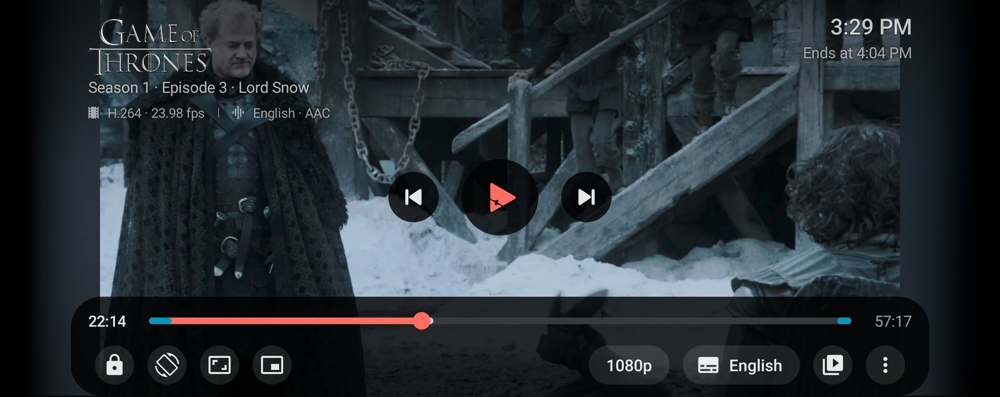
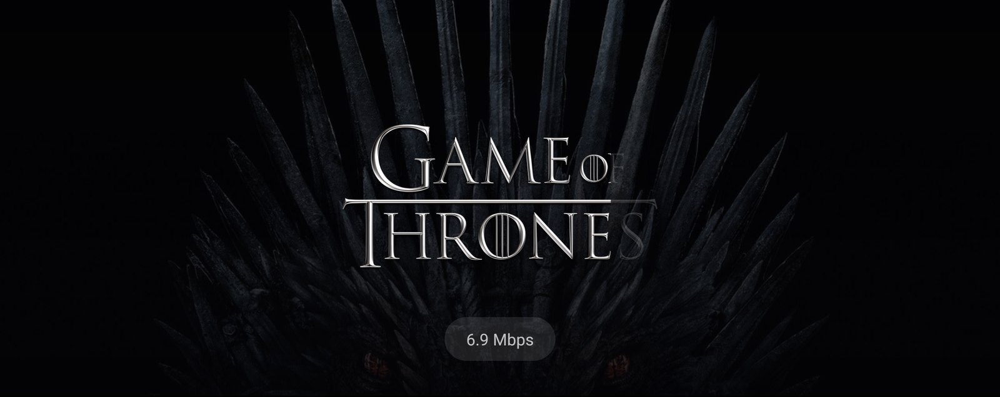
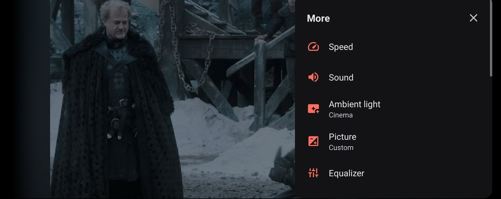
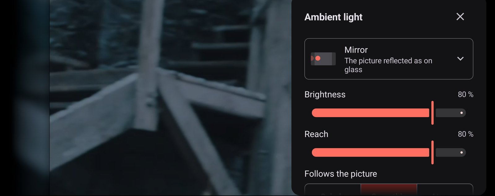
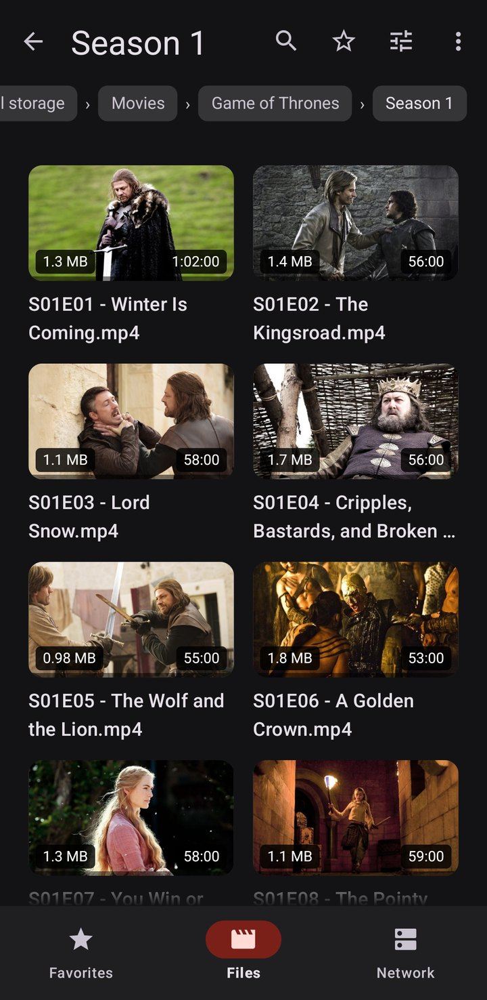
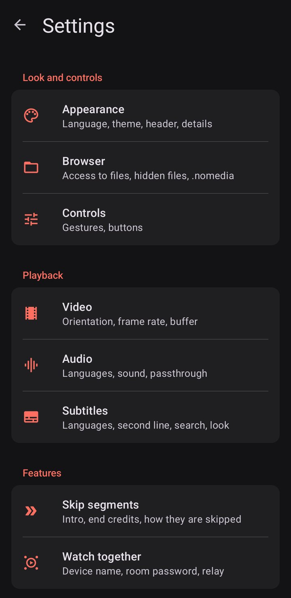
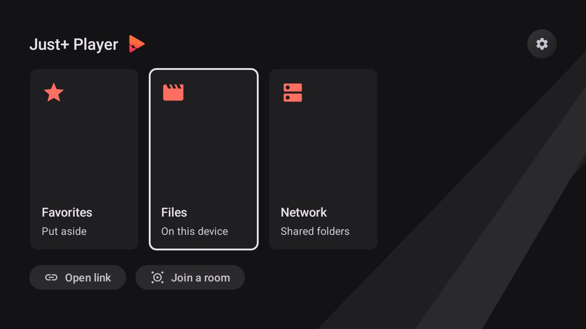
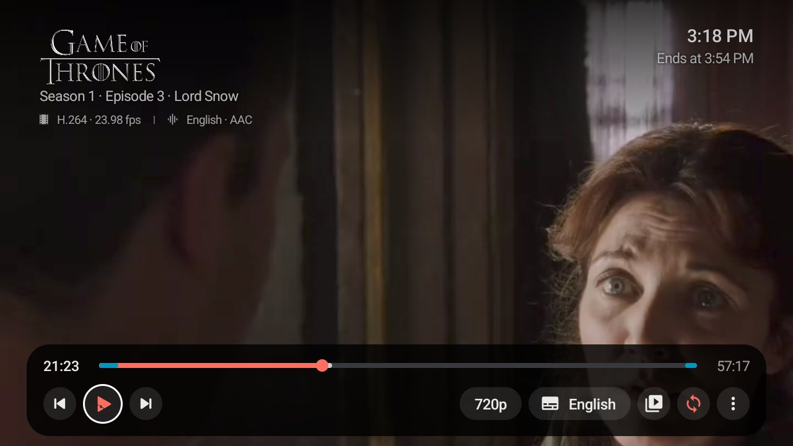
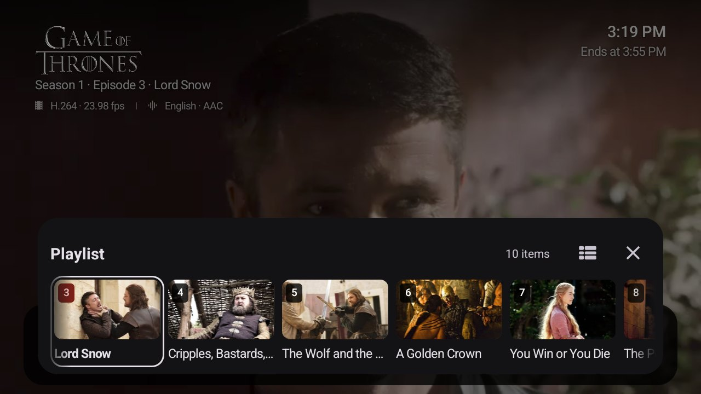
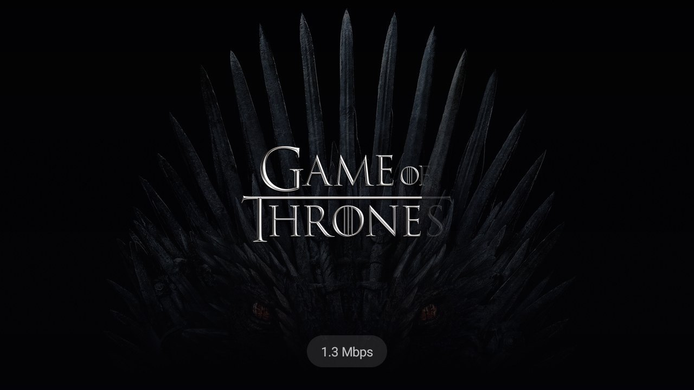

  

<h1 align="center">Just+ Player</h1>

  A video player and file browser for Android phones, tablets and Android TV, built on <a href="https://github.com/androidx/media">Media3</a>. 
  Android 6.0 or later, one APK for every form factor.

  
  
  

A fork of [Just (Video) Player](https://github.com/moneytoo/Player) by Marcel Dopita that keeps what makes it good: no ads, no tracking, very few permissions, and ExoPlayer's `ffmpeg` extension for AC3, E-AC-3, DTS, DTS-HD and TrueHD. On top of that it opens on a file browser with network folders, has a reworked player, and adds the features below.

## Install

 

**Phone, tablet, TV box**: download the APK and open it. **Android TV / Fire TV**: no keyboard needed, install [Downloader](https://www.aftvnews.com/downloader/) and enter the code above.

Installed this way, the app checks for updates itself, shows what changed and installs the new version through the system installer.

## A look around

**Phone.** A title opens on its own artwork while the first frames load. ⋮ More holds everything that is not a button of its own. Ambient light fills the bars beside the picture, here reflecting it as on glass.

 

**Files and settings.** Folders and episodes as tiles with a still from each, and settings grouped by what they are about.

 

**Android TV.** The start page, the player and its controls, the episodes of a season, and the Skip button over an intro.

 
 

Screenshots show <i>Game of Thrones</i> © Home Box Office, Inc., with artwork from <a href="https://www.themoviedb.org/">TMDB</a>, to illustrate the player.

## What Just+ adds

**Files and network folders**

 * Opens on a browser with **Files**, **Network** and **Favorites**; on a TV, on a start page with a card for each, plus Open link and Join a room
 * Files as rows, as tiles with a still from each video, or in columns on a wide screen, with resolution, size, date and where you stopped watching
 * **Network**: SMB shares, WebDAV servers, DLNA/UPnP media servers and TorrServer, found on the local network or typed in
 * The folder a file was opened from becomes its playlist; hold a folder or a file to put it in Favorites

**Player**

 * A header with the title's logo or poster, season and episode, and a details line (resolution · codec · fps · audio), next to the clock and the time playback will end
 * A loading screen built from the title's backdrop and logo when the launching app sends them
 * Tap anywhere on the time bar to seek there; hold the picture to speed up
 * Ten scaling modes, volume up to 200 %, and volume and brightness gestures
 * ⋮ **More**: speed, sound, ambient light around the picture, picture adjustments, equalizer, skips, sleep timer, repeat, online subtitles, watch together, settings. On a TV, Back from a panel opened from More goes back to More

**Picture**

 * **Ambient light** fills the bars around a picture that does not fill the screen: Glow lights them from the picture's edges, Cinema puts the scene blurred behind it, Echo ripples light out from it, Mirror reflects it as on glass. Brightness, reach and how quickly the light follows the picture can be set
 * **Picture** presets, Vivid, Cinema, Bright and Night, or brightness, contrast, saturation, gamma, warmth, shadows and sharpness by hand
 * Match the display's refresh rate, and if you want its resolution, to the video
 * 10-bit AV1 including Dolby Vision profile 10; Dolby Vision profile 7 on an ordinary HEVC decoder

**Sound**

 * A 10-band **equalizer** with Film, Voice, Bass, Treble and TV presets
 * **Sound in this session**: even out loud and quiet (night mode), dialogue louder than the rest, and an audio delay kept separately for decoded sound and for pass-through
 * Pass-through of Dolby and DTS to a receiver, or Dolby encoding of surround sound for a receiver that takes no multichannel PCM
 * A list of preferred audio languages; tracks no decoder on the device can play are listed with the reason

**Subtitles**

 * Their own look with a live preview: size, colour, bold, background and outline
 * A second line in another language, always or only when you pause
 * Search online by hand or automatically when your language is missing, matched to your file by its hash; machine translation when no subtitles in your language exist
 * Files next to a video on the device are picked up by name

**Skip segments**

 * Intros, recaps, ads and end credits drawn on the time bar
 * From the launching app, from the file's own chapters (a chapter counts when its whole name says intro or credits), or looked up online in several databases that vote
 * A Skip button for a few seconds, for the whole segment, or skipping automatically; every skip can be undone

**Watch together**

 * Play, pause and seek in step with someone else, by room, code or invite link, using [LAMPA](https://github.com/lampa-app/LAMPA)'s `lparty` protocol; on a TV the invite is a QR code

**Android TV**

 * A start page and focus every control shows the same way, sized for a remote
 * Left and Right accelerate while held; on a stream a run of presses lands once, after the last one
 * Closing a panel brings the controls back on the button that opened it

**When something breaks**

 * A report in plain language instead of codes, with Copy, Share and Link: Link puts the report on a public page and shows its address as a QR code for you to pass on. Nothing is sent by itself
 * Watchdogs for a load that never starts, a stall in the middle of a film and a picture that stops while the sound goes on

**Launcher integration**

 * Intent extras for position, title, logo and backdrop, subtitles, HTTP headers, a playlist of episodes with per-episode segments and resume positions, quality variants and IMDb/TMDB ids, as sent by [LAMPA](https://github.com/lampa-app/LAMPA)/Lampac and Nuvio. See the [Playlist API](docs/PLAYLIST_API.md)

**Look**

 * Material 3 throughout: dark, light or following the system, AMOLED black, 32 accent colours, and the app language picked in the app

## Supported formats

 * **Audio**: Vorbis, Opus, FLAC, ALAC, PCM/WAVE (μ-law, A-law), MP1, MP2, MP3, AMR (NB, WB), AAC (LC, ELD, HE; xHE on Android 9+), AC-3, E-AC-3, DTS, DTS-HD, TrueHD, IAMF, MPEG-H
 * **Video**: H.263, H.264 AVC (Baseline Profile; Main Profile on Android 6+), H.265 HEVC (including 4:2:2 and 4:4:4 in software), MPEG-4 SP and ASP (XviD, DivX), VP8, VP9, AV1 (8- and 10-bit)
 * **Containers**: MP4, MOV, WebM, MKV, AVI (including OpenDML past 1 GB), Ogg, MPEG-TS, M2TS, MPEG-PS, FLV
 * **Streaming**: DASH, HLS, SmoothStreaming, RTSP
 * **Network folders**: SMB 2/3, WebDAV, DLNA/UPnP, TorrServer
 * **Subtitles**: SRT, SSA/ASS ([limited styling](https://github.com/google/ExoPlayer/issues/8435)), TTML, VTT, DVB

HDR (HDR10+ and Dolby Vision) playback on compatible hardware. AC-4 audio works on devices that ship such a system decoder (e.g. Samsung Galaxy A, S and Z series on Android 11 or later).

## Inherited from Just (Video) Player

 * Horizontal swipe and double tap to seek
 * Vertical swipe to change brightness (left) / volume (right) — can be switched off
 * Pinch to zoom (Android 7+)
 * Picture-in-picture on Android 8+ (resizable on Android 11+), optionally started when you leave the app
 * Resume where you left off, per file
 * App shortcut straight to your videos (Android 7.1+)
 * Third-party equalizer / audio processing support (e.g. [Wavelet](https://github.com/Pittvandewitt/Wavelet))
 * Media Session and Audio Focus support, pause when headphones are disconnected
 * No ads, no tracking, no excessive permissions

## Integration

Another app can launch the player with a playlist and read back what was watched. Every key, how the dub, audio track and subtitle are chosen, and the result callback are in the [Playlist API reference](docs/PLAYLIST_API.md).

## FAQ

### Where are the settings?

In the browser, **⋮ → Settings**; on a TV, the gear on the start page. In the player, **⋮ More → Settings**, or long press ⋮ to go there directly. The App info screen works too.

### Where are my videos?

**Files** lists the folders that hold videos. Without further permission the browser sees what the system media index knows; granting **Access to all files** in Settings → Browser (Android 11+) lets it list every folder. Hidden files and folders with a `.nomedia` file can be shown there as well.

### How do I get to videos on network storage?

**Network → Add network folder.** SMB shares, DLNA media servers and TorrServer on the local network are found by themselves; anything else — including WebDAV — can be added by address. SFTP is not built in: open the video from a file manager that speaks it.

### How do I get subtitles?

 * A subtitle file next to the video with the same name (`video.mkv` → `video.srt`) is picked up automatically on the device; a subtitle the launching app sends along is applied too
 * **⋮ More → Find subtitles online** searches OpenSubtitles and others; in Settings → Subtitles the search can run by itself when your language is missing, and translate when nothing in it exists
 * A subtitle file opened from a file manager is applied to the last video. 📺 On Android TV this is the way to bring your own file: open the video, go back, then open the subtitle file

### How do I change subtitle font, size or color?

**Settings → Subtitles → Appearance**, with a live preview. Long pressing the subtitle button in the player takes you straight there.

### How do I open a streaming link?

**Open link** — in the browser's ⋮ menu, on the TV start page and in the player's ⋮ More. A link on the clipboard is filled in for you. The player is also registered for compatible links, so tapping one in another app should offer it, and sharing a selected URL works as well.

### Are there any media formats it CANNOT play?

ExoPlayer does not handle some older formats such as WMV or [Theora](https://github.com/google/ExoPlayer/issues/4970), Android has no ProRes decoder, and most devices cannot decode [10-bit AVC](https://github.com/moneytoo/Player/issues/87#issuecomment-816228143). Audio-only playback is not a goal — this is a video player.

### How do I get rid of the black bars?

Pinch to zoom, or tap the resize button to cycle Fit → Crop → Fill → 16:9 → 4:3. A long press opens the full list of scaling modes. **Android TV**: long press resize to enter zoom mode, then zoom precisely with Up and Down.

### Bluetooth audio is out of sync

Pause and resume once. If a device is consistently off, Settings → Audio → Audio delay moves the sound against the picture.

### Why does it ask for "Modify system settings"?

The system folder picker, used when the app asks for access to a folder, always follows the current system orientation, even when the player sets its own. Granting `WRITE_SETTINGS` from the App info screen or via adb (`adb shell pm grant com.justplus.player android.permission.WRITE_SETTINGS`) lets the app temporarily enable Auto-rotate around it to partially work around [this imperfection](https://issuetracker.google.com/issues/141968218). Nothing else uses the permission, and the app works without it.

### The orientation button does nothing

Since Android 16 apps cannot [switch orientation](https://android-developers.googleblog.com/2025/01/orientation-and-resizability-changes-in-android-16.html) programmatically, but it can be re-enabled per app: open "Aspect ratio" in system Settings, find Just+ Player and switch it from "Full screen" to "App default".
